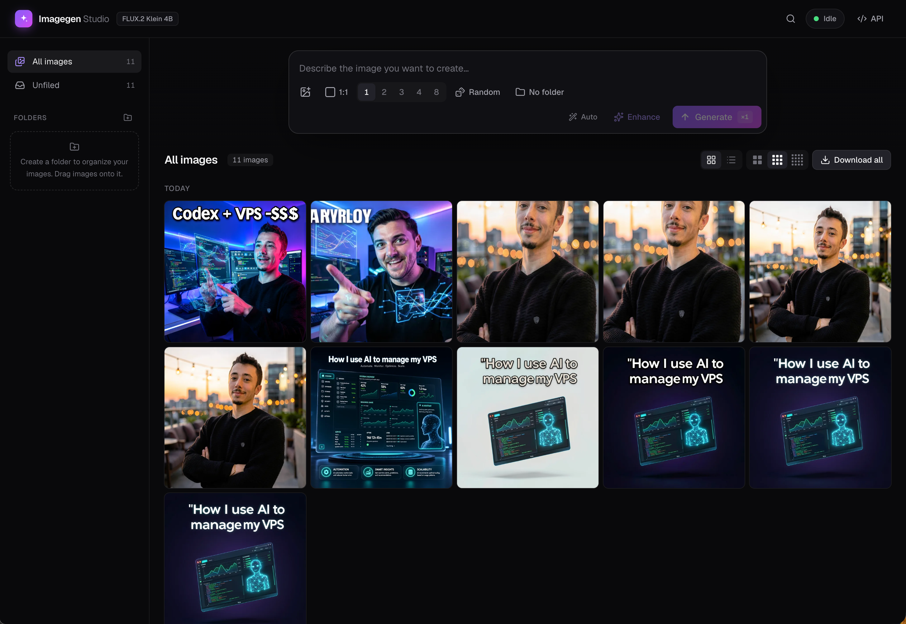

# Imagegen Studio

A local-first AI image generation and editing studio built on **FLUX.2 Klein 4B**.



- **Async queue**: generations run in the background with bounded concurrency, persist across restarts, and retry transient errors automatically.
- **Variants**: up to 8 images per prompt, each with its own seed (fixed seeds give reproducible results: `seed`, `seed+1`, …).
- **Text + image → image**: drag & drop, paste (⌘V) or pick up to 4 reference images, or reuse any generated image as a reference.
- **Inpainting**: paint a mask with brush, eraser, undo and invert. Pixels outside the mask are preserved exactly.
- **Prompt enhancer**: an LLM rewrites vague ideas into FLUX-optimized prompts. It can see your reference images. Use it on demand (✦ Enhance, undoable) or automatically on submit (Auto).
- **Folders**: organize individual images into folders, and pick a folder to generate into (it defaults to the folder you're viewing). Move images by dragging them onto a folder in the sidebar, through the image menu, or by multi-selecting them. **Download all** zips a folder (or everything) with a `manifest.json` of prompts and seeds.
- **Grid or list**: a dense chronological image grid with 3 tile sizes and multi-select (⌘/Shift-click, ⌘A) for bulk move, download and delete. A list view groups images by prompt.
- **Live UI**: SSE-driven skeletons show queue position, elapsed time and retries. There's also a lightbox (zoom/pan, filmstrip, keyboard navigation), downloads, search and infinite scroll. Click any prompt to copy it. The prompt box clears after each generation; press ↑ to bring back previous prompts.
- **API**: everything is scriptable over REST (single, bulk, long-poll `wait`, SSE). OpenAPI docs live at `/api/docs`.

## Quick start

Requirements: Node ≥ 22.13 (Node 24+ recommended) and pnpm.

```bash
pnpm install
```

Put your key in `.env` at the repository root (it's already created from `.env.example`):

```
OPENROUTER_API_KEY=sk-or-...
```

```bash
pnpm dev
```

- Studio: http://localhost:3000
- API: http://localhost:4000/api, with interactive docs at http://localhost:4000/api/docs

To try the app offline without a key, set `IMAGE_PROVIDER=mock` and `TEXT_PROVIDER=mock` in `.env` (generates placeholder gradients).

Production mode: `pnpm build && pnpm start`.

## Keyboard shortcuts

| Where | Keys |
| - | - |
| Anywhere | `/` focus prompt · `⌘K` search |
| Prompt | `↵` generate · `⇧↵` new line · `↑` `↓` previous prompts · `⌘V` paste image |
| Grid | `⌘`/`Shift`-click select · `⌘A` select all · `Esc` clear selection · drag images onto a folder |
| Lightbox | `←` `→` navigate · `D` download · `E` inpaint · `R` use as reference · `I` details · `+` `-` `0` zoom · `Del` delete |
| Inpaint | `B` brush · `E` eraser · `[` `]` brush size · `H` hide mask · `⌘Z` undo |

## Architecture

```
apps/
  api/   NestJS 12 (ESM) — queue, storage, providers, REST + SSE
  web/   Next.js 16 + React 19 + Tailwind 4 + TanStack Query
data/    SQLite database + images (created at runtime, git-ignored)
```

- **Storage**: SQLite through Node's built-in `node:sqlite` (no native build step) and image files on disk. Thumbnails are WebP, generated lazily with `sharp`.
- **Queue** (`apps/api/src/generations/queue.service.ts`): FIFO with `QUEUE_CONCURRENCY` workers. Interrupted jobs are re-queued on boot. Retryable failures (network, 429, 5xx) back off exponentially, up to `QUEUE_MAX_ATTEMPTS`.
- **Live updates**: every job change emits the full generation over `GET /api/events` (SSE); the web app patches its cache from these events.

### Swapping the model / running locally

All model access goes through two interfaces in `apps/api/src/providers/types.ts`:

```ts
interface ImageProvider { generate(req: ImageGenerationRequest): Promise<ImageGenerationResult>; capabilities; ... }
interface TextProvider  { complete(req: TextCompletionRequest): Promise<string>; ... }
```

To move to your own hardware, pick whichever option is easiest:

1. **Write a provider.** Implement `ImageProvider` (e.g. a `DiffusersImageProvider` calling a local Python server, or ComfyUI), register it in `apps/api/src/providers/registry.ts`, and set `IMAGE_PROVIDER=<name>`. `mock.providers.ts` is the smallest example. If your engine supports real masks, set `capabilities.nativeInpainting = true` and you'll receive `req.inpaint = { image, mask }`. Otherwise the app emulates inpainting: it shows the model the marked region, then composites the result through a feathered mask.
2. **Mimic OpenRouter.** Serve OpenRouter's `POST /images` contract locally and point `OPENROUTER_BASE_URL` at it. No code changes are needed.
3. **Prompt enhancer.** Any OpenAI-compatible server works (Ollama, LM Studio, vLLM, llama.cpp). Set `TEXT_BASE_URL=http://localhost:11434/v1` and `TEXT_MODEL=<model>`.

The rest of the app (queue, UI, API) is provider-agnostic.

## API cheat-sheet

```bash
# Queue a generation (returns immediately)
curl -X POST localhost:4000/api/generations -H 'Content-Type: application/json' \
  -d '{"prompt":"a cozy cabin at dusk","count":4,"aspectRatio":"16:9","enhance":true}'

# Wait until finished (long-poll)
curl localhost:4000/api/generations/<id>/wait?timeout=120

# Bulk queue (automation)
curl -X POST localhost:4000/api/generations/bulk -H 'Content-Type: application/json' \
  -d '{"items":[{"prompt":"…","label":"batch-1"},{"prompt":"…","label":"batch-1"}]}'

# Upload images / image-to-image / inpaint
curl -X POST localhost:4000/api/assets -F files=@photo.jpg
curl -X POST localhost:4000/api/generations -H 'Content-Type: application/json' \
  -d '{"prompt":"watercolor style","inputImageIds":["<asset-id>"]}'
curl -X POST localhost:4000/api/generations -H 'Content-Type: application/json' \
  -d '{"prompt":"a red bicycle","inputImageIds":["<asset-id>"],"mask":"data:image/png;base64,…"}'

# Prompt enhancer
curl -X POST localhost:4000/api/prompts/enhance -H 'Content-Type: application/json' -d '{"prompt":"cat on roof"}'

# Folders: create, generate into, move images, download as zip
curl -X POST localhost:4000/api/folders -H 'Content-Type: application/json' -d '{"name":"Product shots"}'
curl -X POST localhost:4000/api/generations -H 'Content-Type: application/json' \
  -d '{"prompt":"…","count":4,"folderId":"<folder-id>"}'
curl -X POST localhost:4000/api/images/move -H 'Content-Type: application/json' \
  -d '{"ids":["<job-id>"],"folderId":"<folder-id>"}'      # folderId null = out of folders
curl -OJ localhost:4000/api/folders/<folder-id>/archive    # or /api/archive?folderId=none, /api/archive (everything)
curl "localhost:4000/api/generations?folderId=<folder-id>"  # filter jobs[].folderId client-side

# Live events
curl -N localhost:4000/api/events
```

Folders hold **images** (the `jobs` of a generation), so the variants of one prompt can live in different folders. `generation.folderId` records the folder the generation was created into.

`inputImages` / `mask` also accept inline data URLs, base64 or http(s) URLs. Set `API_TOKEN` (and `NEXT_PUBLIC_API_TOKEN` for the web app) to require `Authorization: Bearer <token>`.

## Tests

```bash
pnpm --filter api build
pnpm test
```

The end-to-end suite boots the API with mock providers. It covers the queue, variants and seeds, uploads, image-to-image, inpainting pixel preservation, enhancement, retries, cancel/delete, bulk, pagination, SSE, and folders (moves, counts, zip archives, deletion).
