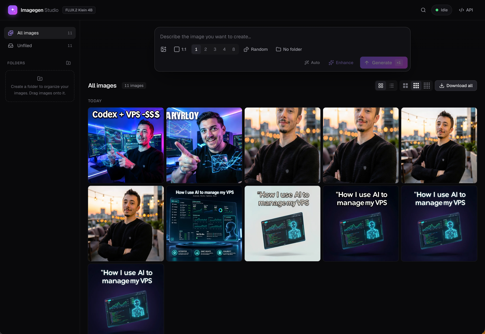

# Imagegen Studio

A fully local AI image generation and editing studio, running on your own GPU through 🤗 diffusers (Apple Silicon/Metal, CUDA, or CPU). Switch models from the header at any time:

- **[FLUX.2 [klein] 4B](https://huggingface.co/black-forest-labs/FLUX.2-klein-4B)**: fast (4 steps), multi-reference editing, native inpainting.
- **Qwen-Image 2.1 Turbo, Q8 GGUF** (default): the [Q8_0 denoiser](https://huggingface.co/AtomicChat/Qwen-Image-2.1-Turbo-GGUF) with the [Q8_0 uncensored Qwen3-VL text encoder](https://huggingface.co/AtomicChat/Qwen-Image-2.1-Turbo-Uncensored-GGUF) (8 steps). Strong text rendering, multi-reference editing; inpainting is emulated.
- **Qwen-Image 2.1 (base), Q8 GGUF**: the original, non-distilled model ([unsloth Q8_0 denoiser](https://huggingface.co/unsloth/Qwen-Image-2.1-GGUF), 7.6 GB, same uncensored text encoder), 30 steps (`QWEN_BASE_STEPS`). About 4× slower than Turbo, but it's what most LoRAs are trained on, and a few only work on it.
- **FLUX 3 Image [klein], Q8 GGUF**: the [Q8_0 denoiser](https://huggingface.co/AtomicChat/FLUX-3-Image-Klein-GGUF) with the [Q8_0 uncensored Qwen3-VL-4B text encoder](https://huggingface.co/AtomicChat/FLUX-3-Image-Klein-TE-Uncensored-GGUF) (16 steps). Multi-reference editing; inpainting is emulated. It's trained on long scene captions, so short prompts work best with ✦ Enhance.



- **Async queue**: generations run in the background with bounded concurrency, persist across restarts, and retry transient errors automatically.
- **LoRAs**: a LoRA button in the prompt box (only shown when the selected model has LoRAs) opens a searchable list of the LoRAs made for that model. Tick any number of them and set each one's strength. Your selection is remembered per model, trigger words are added to the prompt for you, and each generation records its LoRAs ("Run again" reuses them). Ships with 9 LoRAs for Qwen-Image 2.1: realism, detail, anime, and edit tools (see *LoRAs* below). Edit LoRAs are marked **edit** in the picker and need a reference image, and several offer a ready-made prompt ("Use its prompt").
- **Variants**: up to 8 images per prompt (1 by default), each with its own seed (fixed seeds give reproducible results: `seed`, `seed+1`, …).
- **Text + image → image**: drag & drop, paste (⌘V) or pick up to 4 reference images, or reuse any generated image as a reference.
- **Inpainting**: paint a mask with brush, eraser, undo and invert. It uses diffusers' native `Flux2KleinInpaintPipeline` (references work too), and pixels outside the mask are preserved exactly.
- **Upscaling**: upscale any image ×2 or ×4 from its menu (or the lightbox) with [SeedVR2 7B, 8-bit MLX](https://huggingface.co/AbstractFramework/seedvr2-7b-8bit). The result is queued like a generation, keeps the source prompt and folder, and appears in the feed. Results bigger than `UPSCALE_TILE` (1536 px) are made from overlapping tiles blended together, which keeps SeedVR2 7B at ~40 GB peak instead of running out of memory (a single 4096 px pass needs well over 100 GB). Upscalers are pluggable (see *Adding an upscaler*).
- **Uploaded medias**: every image you upload as a reference is kept and listed on its own page (sidebar → Uploaded medias), with multi-select and bulk delete.
- **Prompt enhancer**: an LLM rewrites vague ideas into FLUX-optimized prompts. By default it reuses FLUX.2 klein's own Qwen3 text encoder, so there's nothing extra to download. Optionally use Ollama with a vision model so it can see your references. Use it on demand (✦ Enhance, undoable) or automatically on submit (Auto).
- **Folders**: organize individual images into folders, and pick a folder to generate into (it defaults to the folder you're viewing). Move images by dragging them onto a folder in the sidebar, through the image menu, or by multi-selecting them. **Download all** zips a folder (or everything) with a `manifest.json` of prompts and seeds.
- **Grid or list**: a dense chronological image grid with 3 tile sizes and multi-select (⌘/Shift-click, ⌘A) for bulk move, download and delete. A list view groups images by prompt.
- **Live UI**: SSE-driven skeletons show queue position, elapsed time and retries. There's also a lightbox (zoom/pan, filmstrip, keyboard navigation), downloads, search and infinite scroll. Click any prompt to copy it. The prompt box clears after each generation; press ↑ to bring back previous prompts.
- **API**: everything is scriptable over REST (single, bulk, long-poll `wait`, SSE). OpenAPI docs live at `/api/docs`.

## Quick start

Requirements: Node ≥ 22.13, pnpm, [uv](https://docs.astral.sh/uv/) (Python), and a GPU with ~16 GB free memory (any Apple Silicon Mac with 32 GB+ works).

One-time setup:

```bash
pnpm install
pnpm setup:model
```

For upscaling (Apple Silicon only), also run `pnpm setup:upscale` once: it installs [mlx-gen](https://github.com/lpalbou/mlx-gen) as a uv tool (`~/.local/bin/mlxgen`, its own Python env, with `pillow<12.2` because Pillow 12.2+ breaks its import) and downloads SeedVR2 7B 8-bit (~9 GB) into the HF cache.

`pnpm setup:model` creates the Python env (`apps/inference/.venv`) and downloads all three models (~16 GB + ~17 GB + ~10.5 GB) into the **default Hugging Face cache** (`~/.cache/huggingface/hub`, or `$HF_HOME`), not into the app. Use `pnpm setup:flux`, `pnpm setup:qwen` or `pnpm setup:flux3` to fetch only one. The base (non-Turbo) Qwen-Image 2.1 is optional: `pnpm setup:qwen-base` (~8 GB more).

For LoRAs, add a Civitai API key to `.env` (`CIVITAI_TOKEN=…`, from civitai.com → Account settings → API Keys) and run `pnpm setup:loras` once. It downloads them into `~/.cache/huggingface/loras/` (or `LORA_DIR`).

Pick the model in the header menu; your choice is remembered and each generation records the model it used ("Run again" reuses it). Only one model stays in memory: the first job for the other model swaps it in. `IMAGE_MODEL` in `.env` sets the default.

Then, every time:

```bash
pnpm dev
```

This starts three processes:

- Studio: http://localhost:3000
- API: http://localhost:4310/api, with interactive docs at http://localhost:4310/api/docs
- Inference server (Python): http://127.0.0.1:8000. It loads the model in a few seconds; the UI shows "Warming up the model" meanwhile, and queued jobs wait for it. On an M5 Max, a ~1 MP image takes ~15 s.

`.env` needs no edits. Useful knobs are `INFERENCE_STEPS` (default 4, what the distilled model is tuned for), `INFERENCE_DEVICE`, and `TEXT_PROVIDER`. To try the UI without the model, set `IMAGE_PROVIDER=mock` and `TEXT_PROVIDER=mock`.

Production mode: `pnpm build && pnpm start`.

## Running with Docker Compose

Web and API run as containers; FLUX runs **natively on the Mac** (Docker on macOS can't use the GPU). A small login agent keeps the two in sync: the model server starts when the `api` container starts and stops (unloading the model, freeing memory) when it stops. Containers have no restart policy, so nothing runs until you start it.

One-time setup (after `pnpm setup:model`):

```bash
pnpm docker:agent:install     # installs the launchd agent (~/Library/LaunchAgents/com.imagegen.inference-supervisor.plist)
```

Then:

```bash
docker compose up -d          # start: web, API, and (automatically) the model server
docker compose down           # stop everything, including the model server
```

You can also start or stop the stack from Docker Desktop; the model server follows. Open http://localhost:3000 as usual. The containers use the same `data/` folder as `pnpm dev`. Don't run both at once, since they use the same ports.

- Rebuild after code changes: `docker compose up -d --build`
- Supervisor and model logs: `pnpm docker:logs` (`~/Library/Logs/imagegen/`)
- Remove the agent: `pnpm docker:agent:uninstall`

While the containers are off, the agent only waits for Docker events and uses no CPU or GPU.

## Keyboard shortcuts

| Where | Keys |
| - | - |
| Anywhere | `/` focus prompt · `⌘K` search |
| Prompt | `↵` generate · `⇧↵` new line · `↑` `↓` previous prompts · `⌘V` paste image |
| Grid | `⌘`/`Shift`-click select · `⌘A` select all · `Esc` clear selection · drag images onto a folder |
| Lightbox | `←` `→` navigate · `D` download · `E` inpaint · `R` use as reference · `I` details · `+` `-` `0` zoom · `Del` delete |
| Inpaint | `B` brush · `E` eraser · `[` `]` brush size · `H` hide mask · `⌘Z` undo |

## Architecture

```
compose.yaml  web + api containers (FLUX stays native, see scripts/inference-supervisor.sh)
apps/
  web/        Next.js 16 + React 19 + Tailwind 4 + TanStack Query
  api/        NestJS 12 (ESM): queue, storage, providers, REST + SSE
  inference/  Python FastAPI + diffusers: keeps FLUX.2 klein loaded on the GPU
data/         SQLite database + images (created at runtime, git-ignored)
```

- **Inference** (`apps/inference/server.py`): keeps one model resident and swaps it on demand. FLUX.2 klein loads `Flux2KleinPipeline` (bf16) and shares its weights with `Flux2KleinInpaintPipeline`. Qwen-Image (`qwen_gguf.py`) runs `QwenImage21Pipeline` with the GGUF denoiser kept at Q8 (dequantized per layer), the GGUF text encoder mapped into transformers' `Qwen3VLForConditionalGeneration`, and the encoder's vision tower range-fetched from the official checkpoint so reference images work. FLUX 3 klein (`flux3_gguf.py`) runs diffusers' FLUX.3 distilled modular blocks (without the prompt upsampler) with the GGUF denoiser kept at Q8, the uncensored GGUF Qwen3-VL-4B encoder (language model only), and FLUX.2's VAE, which FLUX 3 shares; BFL's gated repo isn't needed. It exposes `POST /generate` (with a `model` id), `POST /enhance` (chat with the resident model's Qwen text encoder), `POST /models/:id/load`, `POST /cancel/:id` and `GET /health`. GPU work and model swaps are serialized.

- **Storage**: SQLite through Node's built-in `node:sqlite` (no native build step) and image files on disk. Thumbnails are WebP, generated lazily with `sharp`.
- **Queue** (`apps/api/src/generations/queue.service.ts`): FIFO with `QUEUE_CONCURRENCY` workers. Interrupted jobs are re-queued on boot. Retryable failures (network, 429, 5xx) back off exponentially, up to `QUEUE_MAX_ATTEMPTS`.
- **Live updates**: every job change emits the full generation over `GET /api/events` (SSE); the web app patches its cache from these events.

### Swapping the model

All model access goes through two interfaces in `apps/api/src/providers/types.ts`:

```ts
interface ImageProvider { generate(req: ImageGenerationRequest): Promise<ImageGenerationResult>; capabilities; ... }
interface TextProvider  { complete(req: TextCompletionRequest): Promise<string>; ... }
```

- **Another local model**: add a loader to `MODELS` in `apps/inference/server.py` (see `qwen_gguf.py` for a GGUF example) and the same id with its capabilities to `apps/api/src/providers/models.ts`. It then shows up in the model picker and in `GET /api/config` → `image.models`.
- **Another engine** (ComfyUI, MLX, a remote API…): implement `ImageProvider`, register it in `apps/api/src/providers/registry.ts`, and set `IMAGE_PROVIDER=<name>`. `mock.providers.ts` is the smallest example. Set `capabilities.nativeInpainting = false` if your engine has no mask support; the app then emulates inpainting with a marked reference plus mask compositing.
- **Adding an upscaler**: subclass `Upscaler` in `apps/inference/upscalers.py` and implement `upscale_batch()` (tiling and blending come from the base class; in-process, or shelling out to a CLI like `MlxGenUpscaler`), register it in `UPSCALERS`, and add the same id with its label and scales to `apps/api/src/providers/upscalers.ts`. It then appears in every image's Upscale menu and in `GET /api/config` → `upscale.upscalers`. Another engine entirely: implement `UpscaleProvider` (`providers/types.ts`) and register it in `registry.ts`.
- **Adding a LoRA**: add it to `LORAS` in `apps/inference/loras.py` (file name, download URL, sha256, and the model ids it was trained for) and the same id to `apps/api/src/providers/loras.ts` (label, description, trigger word, default strength and `models`, which is the model → LoRA mapping that controls where it shows up). Run `pnpm setup:loras` and restart the inference server. Any model whose diffusers pipeline has `load_lora_weights` can take LoRAs: today that's FLUX.2 klein and Qwen-Image 2.1, but not FLUX 3 klein, which runs as modular blocks.
- **Prompt enhancer via Ollama** (sees reference images): set `TEXT_PROVIDER=openai-compatible`, `TEXT_BASE_URL=http://localhost:11434/v1` and `TEXT_MODEL=qwen3-vl:8b` (any OpenAI-compatible server works).

The rest of the app (queue, UI, API) is provider-agnostic.

## LoRAs

A LoRA is a small set of extra weights (here ~300 MB, versus ~17 GB for the model) that shifts a model toward a style or subject. It only works with the model architecture it was trained on, so each LoRA lists the models it supports.

- **Storage**: `~/.cache/huggingface/loras/` (or `$HF_HOME/loras`, or `LORA_DIR`), next to the other weights and outside the repo. `pnpm setup:loras` downloads missing files and checks their sha256. Civitai needs an API key for downloads, which only that command sends, and only to civitai.com (the signed CDN redirect is followed without it).
- **Runtime** (`apps/inference/loras.py`): the first job that turns a LoRA on loads it into the resident pipeline's denoiser with PEFT as a named adapter, which takes a second or two. After that, every job turns on exactly the LoRAs it asks for, at their strengths, and turns the others off, so switching costs nothing. The base weights are never changed. On the GGUF models, each LoRA runs as a small extra branch next to the quantized layers. Adapters are dropped when the model is swapped out and reloaded on next use.
- **Format**: Civitai/ComfyUI files (`diffusion_model.*`, `lora_unet_*`, `lora_down`/`lora_up` + `alpha`) are converted to diffusers names. ComfyUI fuses Qwen-Image 2.1's MLP gate and up projections into one `gate_up` layer, while diffusers keeps them apart, so those LoRA weights are split row-wise, which gives exactly the same result.
- **Trigger words**: when a LoRA with a trigger word is on, the API adds the word to the start of the prompt at generation time, unless the prompt already contains it. The stored prompt stays as you typed it.
- **API**: `"loras": [{"id": "candid-amateur-iphone-qwen21", "scale": 0.8}]` on `POST /api/generations` (`scale` defaults to the LoRA's `defaultScale`). `GET /api/config` → `image.loras` lists each LoRA with its `models` and an `issue` (for example, "not downloaded").

`T` = Qwen-Image 2.1 Turbo, `B` = Qwen-Image 2.1 base. Most were trained on the base model; they also run on Turbo, a bit less faithfully.

| LoRA | What it does | Models | Trigger / prompt | Strength |
| - | - | - | - | - |
| [Candid Amateur iPhone](https://civitai.com/models/3012015) | Plain phone-photo look | T, B | `cndamiph` (added for you) | 1 |
| [Lenovo UltraReal](https://civitai.com/models/1662740) | General photorealism | T, B | none | 0.8 |
| [Detailifier](https://civitai.com/models/430687) | More detail in faces, skin, fabric, materials | T, B | none | 0.6 (0.2–1) |
| [Anime FUSAL v3](https://huggingface.co/MicksHF/Qwen-Image-2.1-Anime-Fusal) | Anime illustration, 5 looks | B | `fusal style.` + structured prompt | 0.7–1 |
| [Anime FUSAL Turbo preview](https://huggingface.co/MicksHF/Qwen-Image-2.1-Anime-Fusal) | The author's weaker Turbo version | T | same | 0.7–1 |
| [Consistency](https://civitai.com/models/2969143) | **Edit**: edits keep the original framing | T, B | your edit instruction | 1 |
| [Character Sheet](https://civitai.com/models/2995608) | **Edit**: one photo → 3×2 character sheet | B | its fixed prompt | 1 |
| [Deblur anything](https://civitai.com/models/2975487) | **Edit**: removes blur | T, B | `Wibble snargle floof` (added for you) | 1 |
| [Image Blend Fusion](https://civitai.com/models/2548669) | **Edit**: blends a pasted cut-out into the picture | T, B | `Blend the <thing> into the <place> seamlessly` | 1 |

Licenses vary (several are non-commercial, like Qwen-Image 2.1 itself): check each page.

## API cheat-sheet

```bash
# Queue a generation (returns immediately). "model" is optional (default: IMAGE_MODEL)
curl -X POST localhost:4310/api/generations -H 'Content-Type: application/json' \
  -d '{"prompt":"a cozy cabin at dusk","count":4,"aspectRatio":"16:9","enhance":true,"model":"qwen-image-2.1-turbo"}'

# With a LoRA (its trigger word is added for you)
curl -X POST localhost:4310/api/generations -H 'Content-Type: application/json' \
  -d '{"prompt":"two friends laughing in a kitchen","model":"qwen-image-2.1-turbo","loras":[{"id":"candid-amateur-iphone-qwen21","scale":1}]}'

# Wait until finished (long-poll)
curl localhost:4310/api/generations/<id>/wait?timeout=120

# Bulk queue (automation)
# Upscale an image ×2 (asset id from generation.jobs[].image.id, or an upload)
curl -X POST localhost:4310/api/upscales -H 'Content-Type: application/json' -d '{"imageId":"<asset-id>","scale":2}'

# List / bulk-delete uploaded images
curl localhost:4310/api/assets
curl -X POST localhost:4310/api/assets/delete -H 'Content-Type: application/json' -d '{"ids":["<asset-id>"]}'

curl -X POST localhost:4310/api/generations/bulk -H 'Content-Type: application/json' \
  -d '{"items":[{"prompt":"…","label":"batch-1"},{"prompt":"…","label":"batch-1"}]}'

# Upload images / image-to-image / inpaint
curl -X POST localhost:4310/api/assets -F files=@photo.jpg
curl -X POST localhost:4310/api/generations -H 'Content-Type: application/json' \
  -d '{"prompt":"watercolor style","inputImageIds":["<asset-id>"]}'
curl -X POST localhost:4310/api/generations -H 'Content-Type: application/json' \
  -d '{"prompt":"a red bicycle","inputImageIds":["<asset-id>"],"mask":"data:image/png;base64,…"}'

# Prompt enhancer
curl -X POST localhost:4310/api/prompts/enhance -H 'Content-Type: application/json' -d '{"prompt":"cat on roof"}'

# Folders: create, generate into, move images, download as zip
curl -X POST localhost:4310/api/folders -H 'Content-Type: application/json' -d '{"name":"Product shots"}'
curl -X POST localhost:4310/api/generations -H 'Content-Type: application/json' \
  -d '{"prompt":"…","count":4,"folderId":"<folder-id>"}'
curl -X POST localhost:4310/api/images/move -H 'Content-Type: application/json' \
  -d '{"ids":["<job-id>"],"folderId":"<folder-id>"}'      # folderId null = out of folders
curl -OJ localhost:4310/api/folders/<folder-id>/archive    # or /api/archive?folderId=none, /api/archive (everything)
curl "localhost:4310/api/generations?folderId=<folder-id>"  # filter jobs[].folderId client-side

# Live events
curl -N localhost:4310/api/events
```

Folders hold **images** (the `jobs` of a generation), so the variants of one prompt can live in different folders. `generation.folderId` records the folder the generation was created into.

`inputImages` / `mask` also accept inline data URLs, base64 or http(s) URLs. Set `API_TOKEN` (and `NEXT_PUBLIC_API_TOKEN` for the web app) to require `Authorization: Bearer <token>`.

## Tests

```bash
pnpm --filter api build
pnpm test
```

The end-to-end suite boots the API with mock providers. It covers the queue, variants and seeds, uploads, image-to-image, inpainting pixel preservation, enhancement, retries, cancel/delete, bulk, pagination, SSE, and folders (moves, counts, zip archives, deletion).
